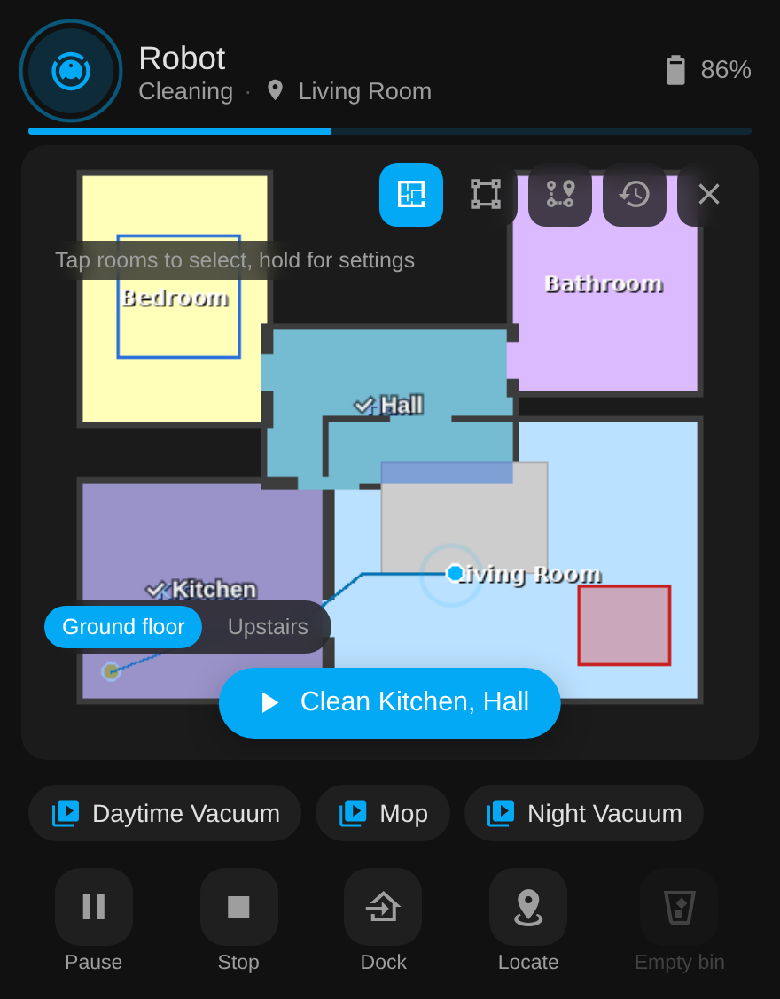
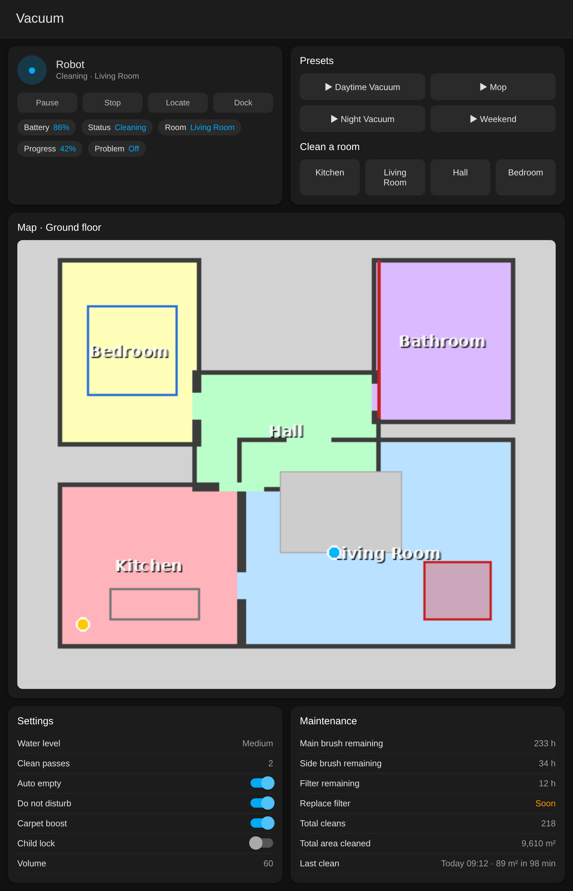

# Tapo Robot Vacuum — Home Assistant Integration

Local-only Home Assistant integration for **TP-Link Tapo robot vacuums** (RV20, RV30 Max Plus,
RV30C, RV50 and relatives). The `tapo_rv30` domain name is historical; it's one integration for the range. No cloud dependency: it talks directly to the vacuum over your LAN.

Newer firmware uses the **TPAP / SPAKE2+** protocol, implemented here from the work in
[python-kasa PR #1592](https://github.com/python-kasa/python-kasa/pull/1592). Units that
still use the older AES scheme (RV30C, RV30C Mop) are detected automatically and handled
through python-kasa.

## Features

- Full vacuum control — start, pause, stop, dock, locate, spot clean
- **Bundled Lovelace card**: tap rooms or drag a zone on the live map, presets and controls,
  zero setup
- **Room-by-room cleaning** via `tapo_rv30.clean_rooms` service, or the native
  `vacuum.clean_area` action (map rooms to Home Assistant areas in the vacuum
  entity's settings)
- **Current Room** sensor, inferred from the vacuum's position on the map
- **Last Clean Map** image: where the robot actually went on its last run (cleaned area, path, start and end)
- **Schedules** managed from Home Assistant: add, change, enable / disable and remove the robot's own schedules
- **Schedules** sensor listing the Tapo-app schedules, and `tapo_rv30.run_schedule`
  to start one now
- **Presets**: one button per preset saved in the Tapo app, plus `tapo_rv30.run_preset`
- Entities adapt to the model: optional settings (AI avoidance, re-mopping, pet deep clean, ...)
  appear only when the robot supports them
- Live **map image** (transparent PNG, theme-friendly) with rooms, no-go zones, virtual walls,
  carpets, saved zones, furniture, the robot and its cleaning path. `room_geometry` /
  `map_geometry` attributes for custom cards
- Fan speed selection (Quiet / Standard / Turbo / Max / Ultra)
- Water level select (Off / Low / Medium / High)
- Clean passes select (1 / 2 / 3)
- Battery, charging, clean progress, mop attached, do-not-disturb-active, problem and Wi-Fi
  signal sensors; read-only firmware update entity
- "Replace soon" sensors per consumable and lifetime totals (cleans, area, hours) for statistics
- Events on clean start / finish / error for automations
- Map as both a camera and an image entity (instant updates in the frontend)
- Adaptive polling (10 s while cleaning, your chosen interval otherwise), reconfigure and
  reauth from the integration page, a repair issue when the robot stops answering locally
- Error state sensor (e.g. "Ok", "Dust Bin Removed", "Trapped")
- Consumable wear sensors (main brush, side brush, filter, sensor, charge contacts)
- Zone cleaning via `tapo_rv30.clean_zone`; suction / water / passes per run via `tapo_rv30.clean_rooms`, and per-room stored settings via `tapo_rv30.set_room_settings` where the firmware allows it
- Empty Bin button (self-empty docks), Wash Mop / Dry Mop / Remove Hair buttons (Omni docks, created only when the dock answers) and consumable reset buttons
- Auto Firmware Update switch, Auto Empty switch and Auto Empty Mode select (Smart / Light / Balanced / Max, self-empty docks), Do Not Disturb (with start / end times), Child Lock and Carpet Boost switches
- Voice volume control
- Last Clean sensor with run totals
- Config flow UI with reconfigure and reauth; diagnostics download for bug reports
- Integration icon (HA 2026.3+), served from the integration itself

## Requirements

- Home Assistant 2026.3 or newer (the native clean-area feature the integration uses arrived in 2026.3; HACS enforces this)
- [HACS](https://hacs.xyz) installed
- Tapo RV20 / RV30 on firmware **1.2.x+** (TPAP protocol). Models that use the
  older AES scheme (RV30C, RV30C Mop) are detected automatically but untested, see #25.
- Python package `ecdsa` (installed automatically by HACS)

## Installation via HACS

[](https://my.home-assistant.io/redirect/hacs_repository/?owner=epg-pers&repository=tapo-rv30-ha&category=integration)

Click the button above, or manually:

1. In HACS → **Integrations** → ⋮ menu → **Custom repositories**
2. Add `https://github.com/epg-pers/tapo-rv30-ha` as category **Integration**
3. Install **Tapo Robot Vacuum**
4. Restart Home Assistant
5. **Settings → Devices & Services → + Add Integration → Tapo Robot Vacuum**
6. Enter your vacuum's IP address, Tapo account email, and password

## Services

| Service | What it does |
|---|---|
| `tapo_rv30.clean_rooms` | Clean named rooms (partial match). Optional `map`, `suction`, `water`, `passes` for this run. |
| `tapo_rv30.clean_zone` | Clean rectangles given in map mm, same frame as the `position_mm` attribute. |
| `tapo_rv30.set_room_settings` | Per-room suction / water / passes stored on the robot. Rejected by RV30 Max Plus firmware 1.3.3 (see below); use `clean_rooms` with levels or a preset there. |
| `tapo_rv30.run_schedule` | Replay a saved schedule's rooms and settings now. The vacuum has no "run schedule by id" call, so the settings are re-sent and the clean started. |
| `tapo_rv30.run_preset` | Start a preset saved in the Tapo app, by name or id. |
| `tapo_rv30.set_map` | Switch the active map (multi-floor). |
| `tapo_rv30.add_schedule` | Create a schedule on the robot: time, days, rooms / preset / whole house, levels. Returns the id. |
| `tapo_rv30.set_schedule` | Change a schedule (enable / disable, time, days, rooms, levels). |
| `tapo_rv30.remove_schedule` | Delete one schedule or all. |
| `tapo_rv30.go_to` | Drive to a point (x, y in map mm) on robots with go-to-point; `vacuum.stop` cancels it. |
| `tapo_rv30.get_clean_records` | Cleaning history and lifetime totals as a service response. |
| `tapo_rv30.send_raw` | Send any device method with params and get the response back (use with "Return response" in Developer Tools). Refused while the robot is working unless `force: true`; see the protocol notes for why. |

Bad input (unknown room, map, option) raises an error with the available
names in it, so it shows in the UI and in automation traces.

## Map card calibration

The map camera's `calibration_points` attribute holds three ready-made points for the
[Xiaomi Vacuum Map Card](https://github.com/PiotrMachowski/lovelace-xiaomi-vacuum-map-card),
in the millimetre frame that `tapo_rv30.clean_zone` expects. Paste them into the card's
`calibration_source.calibration_points` and point zone cleaning at `tapo_rv30.clean_zone`.
The `map_geometry` and `room_geometry` attributes give the full mm to pixel transform and
each room's pixel bounds for custom cards.

## Known issue: firmware updates and local access

Several users report that an RV30 Max (Plus) firmware update silently breaks local access
on port 4433 (connection refused or TLS handshake failure) until the robot is power-cycled;
TP-Link's forum reply is that third-party local access is unsupported. If polling stops
after an update on an unchanged network, reboot the vacuum and consider turning off
automatic firmware updates in the Tapo app. Thanks to @jan-tdy for documenting this.

## The card



*Mock-up with a made-up house.*

The integration ships its own Lovelace card and registers it for you: after installing
and restarting, add a card, pick **Tapo Vacuum** and choose the vacuum. Or in YAML:

```yaml
type: custom:tapo-rv30-card
entity: vacuum.robot
```

- Tap rooms on the live map to select them, then **Clean**; hold a room to set its suction,
  water and passes. Switch to zone mode and drag a rectangle, or tap a saved zone. Taps map
  to rooms exactly, no calibration. A floor switcher appears when the robot has several maps.
- Status, current room, battery and progress in the header; a banner when the robot reports a
  problem.
- Preset chips (one per preset saved in the Tapo app), start/pause, stop, dock, locate and
  empty-bin controls, greyed out when they don't apply.
- Follows your theme (light and dark). Options: `name`, `show_presets`, `show_controls`, `rotate` (0 / 90 / 180 / 270, for maps the robot scanned sideways).

No separate HACS frontend install, no resources to add.

## Dashboard



*Mock-up of the example dashboard with a made-up house, rendered through the integration's map code.*

[`examples/dashboard.yaml`](examples/dashboard.yaml) is a ready-made view: controls, status
chips, the live map, preset buttons, one-tap room cleaning, settings and maintenance.
Replace `robot` in the entity ids with your vacuum's name. The chip rows use
[Mushroom](https://github.com/piitaya/lovelace-mushroom) from HACS; everything else is stock.

[`examples/automations.yaml`](examples/automations.yaml) shows notifications from the
`tapo_rv30_clean_finished` / `tapo_rv30_error` events and a local weekday schedule that
runs a preset, replacing the Tapo cloud automation.

## Events

| Event | When | Data |
|---|---|---|
| `tapo_rv30_clean_started` | a clean begins | `device`, `status_code`, `current_room` |
| `tapo_rv30_clean_finished` | a running or paused clean ends (stopped, docking) | `device`, `status_code`, `record` (area, minutes, bin emptied, preset name) when the robot logged one |
| `tapo_rv30_error` | the robot reports a new error | `device`, `code`, `error`, `current_room` |

## Standalone CLI

[`tapo_vacuum.py`](tapo_vacuum.py) is a standalone command-line tool (no HA required).
It uses the original TPAP handshake (P-256 suites only); the integration's `tpap.py`
is the maintained transport.

```bash
pip install requests ecdsa cryptography lz4 Pillow
python3 tapo_vacuum.py status
python3 tapo_vacuum.py map
python3 tapo_vacuum.py clean kitchen lounge
```

## Supported Models

- **RV30 Max Plus (EU)**, firmware 1.3.3, tested on every release with HA 2026.10
- **RV20 Max Plus (EU)**, firmware 1.2.0, reported working

Entities are created from what the robot reports it can do (`getComponentList` and a
settings probe), so other Tapo RobovAC models should work with the features they have;
the RV50 Pro Omni has been reported working on a fork (its dock buttons here are untested). AES-transport models (RV30C) are
supported on a best-effort basis with no test hardware; please report results on #25.

## Protocol notes — room cleaning

The `setSwitchClean` payload for selective room cleaning was reverse-engineered here
from live device traffic and later contributed to
[python-kasa](https://github.com/python-kasa/python-kasa)
([#1660](https://github.com/python-kasa/python-kasa/pull/1660)).

The payload is:

```json
{
  "clean_mode": 3,
  "clean_on": true,
  "clean_order": true,
  "force_clean": false,
  "map_id": <int>,
  "room_list": [<room_id>, ...],
  "start_type": 1
}
```

`clean_mode` values: `0` whole house, `1` whole house with per-room settings, `2` spot,
`3` selected rooms (`room_list`), `4` zones (`area_list` of rectangles in mm, which is also
what the app uses for spot clean), `5` a saved preset (`custom_rule_id`, listed by
`getCustomizationRulesInfo`). `room_list` holds the room ids, which are the pixel values
in the LZ4 map. `tapo_rv30.send_raw` lets you try any method against your own robot.

**Per-room settings.** The app writes them with `setCleanAttr {"type": "custom", "area_list":
[...]}` (`RobotRepoClean.X2` in the app). RV30 Max Plus firmware 1.3.3 answers -1001 to every
shape of that call, and -1008 to `getCleanAttr {"type": "custom"}`, so on that firmware the
only per-room settings that stick are the ones inside a preset. `set_room_settings` stays for
firmware that accepts it and explains itself when it is refused; the card's long-press sheet
starts a clean of that room with the chosen levels instead.

**Do not probe a robot while it is working.** On 2026-10-21 an RV30 Max Plus was sent a
batch of read-only setup and backup queries lifted from the app (`getQsComponentList`,
`getInheritInfo`, `getCommissionedStatus`, `getMatterSetupInfo`, `getMapBRProcess`,
`getOflMapSwitch`) about 38 minutes into a scheduled clean. Within seconds it aborted the
run with an error, its saved maps and clean history were gone, and the map backups in the
Tapo app with them. None of those methods is documented as destructive and the cause is
not proven, but the timing is hard to ignore. `send_raw` therefore refuses anything but the
methods the integration itself uses while the robot is cleaning, returning or paused,
unless you pass `force: true`. Probe docked, and leave setup, inherit, commissioning and
map backup / recovery methods alone unless you can afford to remap.

Furniture placed in the app comes back from `getFurnitureInfo {"map_id": <int>}` (and inside
the map blob) as `{id, type, angle, vertexs}`; the map camera lists it in
`map_geometry.furniture`. Type codes confirmed so far: `201` dining table. If you have other
furniture on your map, open an issue with the code and what it is and it will be added.

## Credits

The TPAP / SPAKE2+ transport code (`custom_components/tapo_rv30/tpap.py` and
`tapo_vacuum.py`) is derived from the
[python-kasa](https://github.com/python-kasa/python-kasa) project
([PR #1592](https://github.com/python-kasa/python-kasa/pull/1592)), which is
licensed under GPL-3.0-or-later.

Thanks to the people whose forks and PRs fed back in: @cheesyturkey (command fixes,
settings and dock entities), @jan-tdy (batching, retries, room geometry, schedules),
@peggleg (AES transport, schedules), @danieyal (TPAP hardening, charging sensor),
@Charles226 (security review), @cavefire (presets, capability discovery),
@ckarlof (map-card calibration), @G0LDENWASTAKEN (HA 2026.8 fix).

## License

This project is licensed under the GNU General Public License v3.0 or later.
See [`LICENSE`](LICENSE) for the full text.
