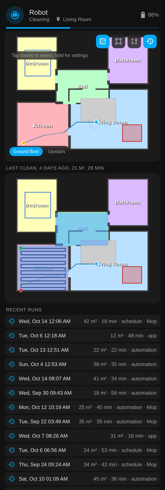
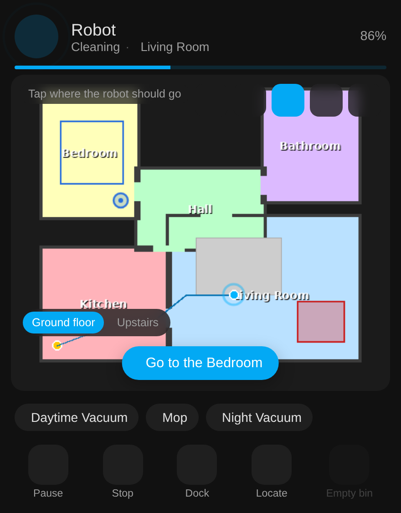

# The card and dashboards

The map card is bundled with the integration: add a card, pick **Tapo Vacuum**, done. For a
whole dashboard in one step, use the [strategy](#whole-dashboard-in-one-line).

{ width="300" }
{ width="300" }

*Mock-ups with a made-up house, rendered through the integration's own map code.*

## Adding the card

Pick **Tapo Vacuum** in the card picker, or in YAML:

```yaml
type: custom:tapo-rv30-card
entity: vacuum.robot
```

| Option | Default | What it does |
|---|---|---|
| `entity` | | The Tapo vacuum (required) |
| `name` | the entity's name | Title at the top of the card |
| `show_presets` | `true` | The row of Tapo-app presets under the map |
| `show_controls` | `true` | Start, pause, stop, dock, locate and empty bin |
| `rotate` | `0` | 0, 90, 180 or 270, for maps the robot scanned sideways |

All of these are in the card's visual editor too.

## Using the map

The buttons at the top right of the map switch what a tap does.

- **Rooms**: tap rooms to select them, then press **Clean**. Hold a room to see when it was last
  cleaned and how much of it the robot covered, and to clean it with chosen suction, water and
  passes.
- **Zone**: drag a rectangle to clean it, or tap one of the saved zones from the Tapo app.
- **Go to**: tap a point and press **Go**; the robot drives there. Hidden on robots without
  go-to-point.
- **Status**: the last clean map, the recent runs and consumable life.
- **Floors**: with several maps, chips at the bottom switch floors.

{ width="300" }
{ width="300" }
{ width="300" }

*Room sheet, status panel and go-to tool (mock-ups).*

## Whole dashboard in one line

Create a dashboard (Settings, Dashboards, Add dashboard, New dashboard from scratch), open its
raw configuration editor and replace the contents with:

```yaml
strategy:
  type: custom:tapo-rv30
```

It builds a view per robot: the card, one-tap room buttons, presets, the last clean map,
status, maintenance, settings, schedules and totals, all from the entities the integration
created, so it follows renames and models. A floor switcher appears when the robot has
several maps, and the header shows status, current room, battery and progress, with a banner
when the robot reports a problem.

## Hand-built dashboard

[`examples/dashboard.yaml`](https://github.com/epg-pers/tapo-rv30-ha/blob/main/examples/dashboard.yaml)
is a ready-made view with controls, status chips, the live map, presets, one-tap rooms,
settings and maintenance. Its chip rows use [Mushroom](https://github.com/piitaya/lovelace-mushroom).

{ width="640" }

## Other map cards

The [Xiaomi Vacuum Map Card](https://github.com/PiotrMachowski/lovelace-xiaomi-vacuum-map-card)
works with the map camera; the calibration points are in
[services and events](services.md#xiaomi-vacuum-map-card-calibration).
