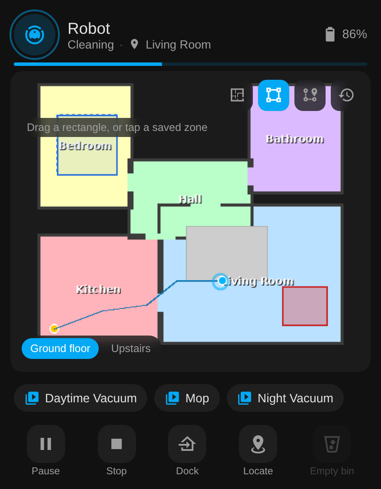
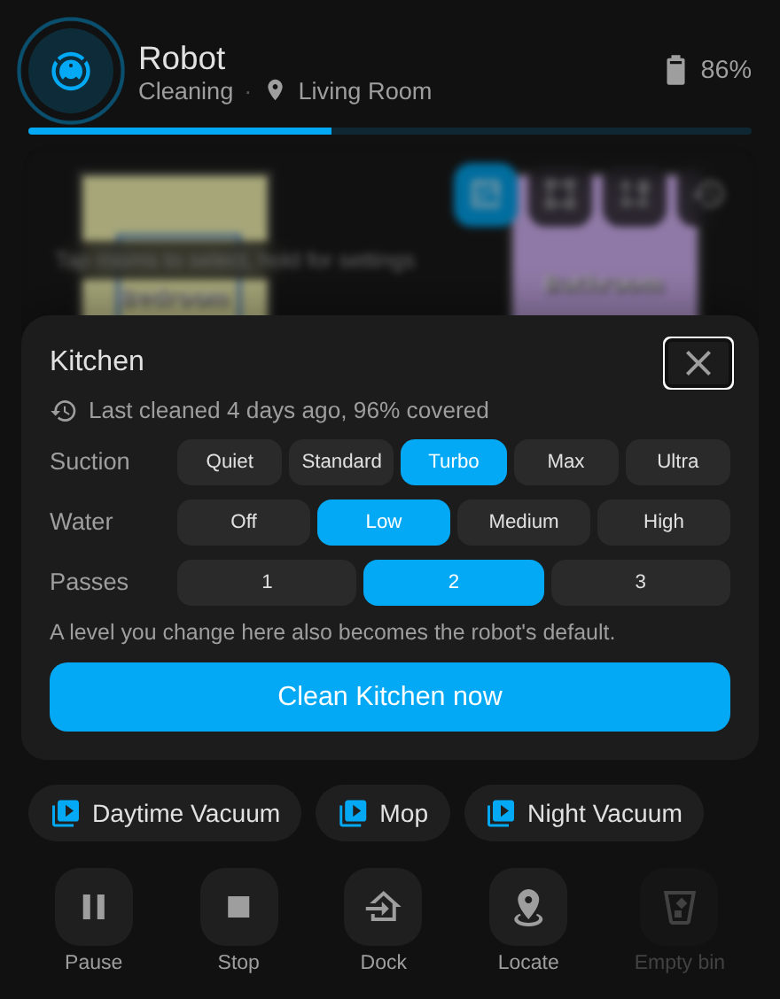

# Tapo Robot Vacuum for Home Assistant

Local-only control of TP-Link Tapo robot vacuums (RV20, RV30 Max Plus, RV30C, RV50 and
relatives), with a live map card bundled in. No cloud, no extra downloads.

[Install with HACS](https://my.home-assistant.io/redirect/hacs_repository/?owner=epg-pers&repository=tapo-rv30-ha&category=integration){ .md-button .md-button--primary }
[Get started](getting-started.md){ .md-button }

  
  
  

*Mock-ups with a made-up house. More of the card, including the status panel and the go-to
tool, on [the card and dashboards](card.md).*

## What is where

- [Getting started](getting-started.md): what you need, install, options, updates, supported
  models.
- [The sidebar page](panel.md): map, schedules editor, history, rooms, drive, maintenance,
  settings.
- [The card and dashboards](card.md): card options, map modes, the one-line dashboard.
- [Voice and automations](automations.md): Assist sentences, device triggers, blueprints.
- [Entities](entities.md): everything the integration creates, by platform.
- [Services and events](services.md): every service with its fields, the events, and the
  Xiaomi map card calibration.
- [Matter](matter.md): pairing state, setup code, the pairing window and why the code does
  not change.
- [Protocol notes](protocol.md): what the robot answers locally, learned from live traffic
  and the Tapo app, including the warning about probing a working robot.
- [Troubleshooting](troubleshooting.md): symptoms, causes and fixes for the usual problems.

## Elsewhere

- [Changelog](changelog.md): every release, newest first.
- [Contributing](contributing.md): reporting bugs and working on the code.
- [Issues](https://github.com/epg-pers/tapo-rv30-ha/issues) and the
  [source](https://github.com/epg-pers/tapo-rv30-ha) on GitHub.
