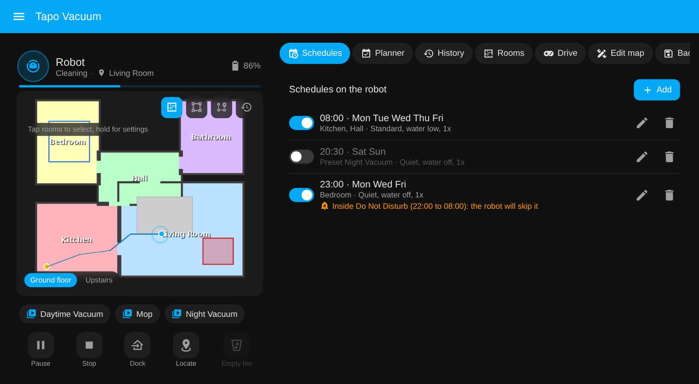
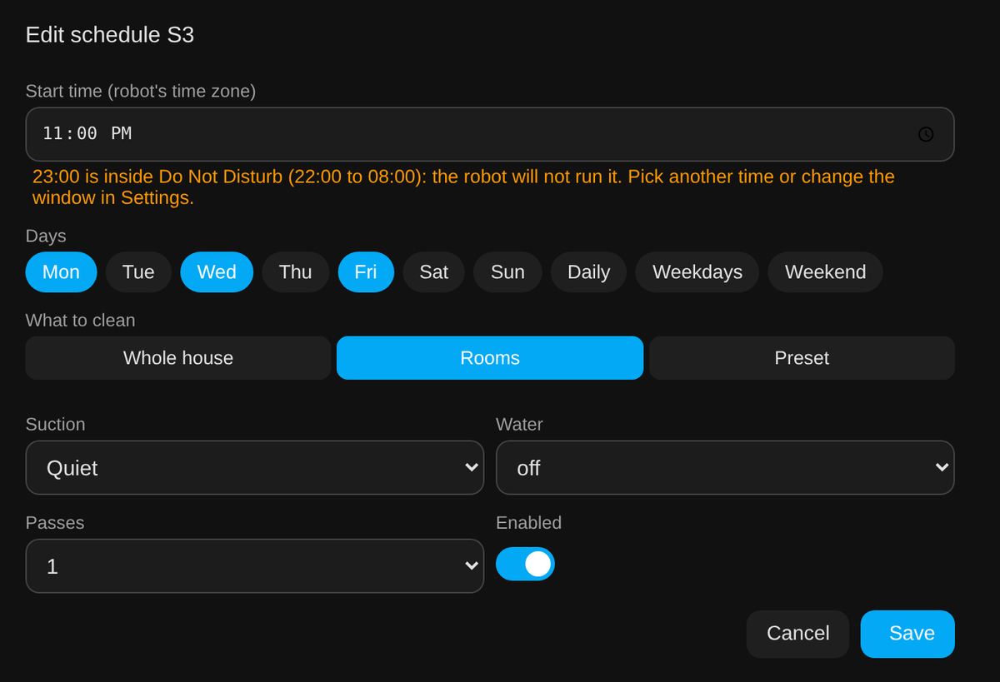
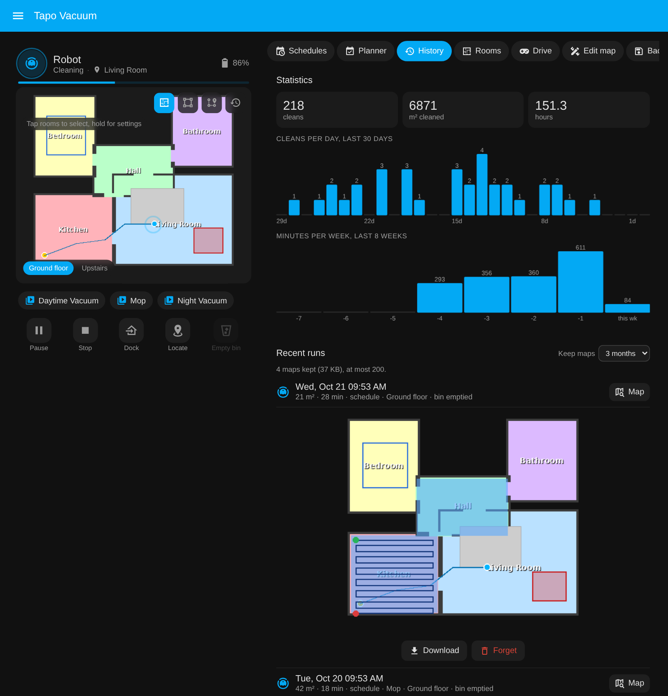
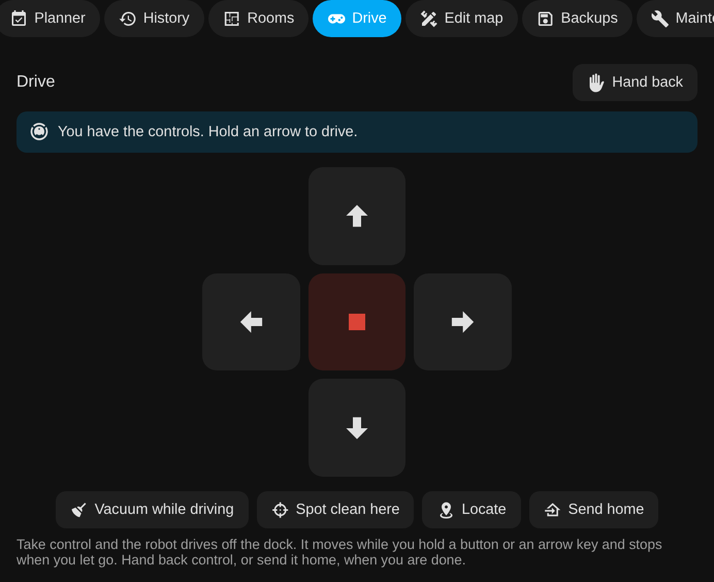

# The sidebar page

The integration adds **Tapo Vacuum** to the Home Assistant sidebar: one page with
everything it knows, so you do not have to build a dashboard to get going. The bundled
card is still there for your own dashboards; the page is the full-size version.

{ width="760" }

*Mock-up with a made-up house and made-up runs.*

## What is on it

### Map

The bundled card, full size: tap rooms, draw zones, floors, presets, controls, the status
panel with the last clean map, and the go-to tool (tap a point, press Go).

### Schedules

The robot's own schedules, the ones it runs with or without the app. Add, edit, enable or
disable and delete them with a form (start time, days, rooms or a preset or the whole
house, suction, water, passes). Nothing is stored in Home Assistant; it all goes to the
robot through `add_schedule`, `set_schedule` and `remove_schedule`.

A schedule whose start time falls inside the robot's **Do Not Disturb** window is flagged
in the list and in the editor, because the robot keeps it but never runs it (verified on an
RV30 Max Plus; the Tapo app shows the same warning). Saving or enabling one asks first. The
Do Not Disturb times are editable on the Settings tab.

{ width="640" }

### Planner

Keeps each room within a target such as "every 2 days" and cleans the due rooms when
nobody is home, inside your time window, with motion sensors keeping it out of rooms in use.
It starts off and in preview mode. Everything about it is on [the planner](planner.md) page.

### History

Lifetime totals, cleans per day for the last 30 days, minutes per week for the last 8
weeks, and the recent runs with how they were started.

{ width="760" }

### Rooms

Each room with how recently it was cleaned and how much of it the robot covered, with a
one-tap clean button.

### Drive

The app's remote control. Take control and the robot drives off the dock; hold an arrow
button, or an arrow key, and it moves until you let go. Stop, vacuum while driving, spot
clean where it stands, locate, send it home. The map on the left follows it. Verified on an
RV30 Max Plus. If yours misbehaves, press Stop or Send home.

{ width="520" }

### Edit map

Draw on the live map and save the result to the robot - no app. Pick a tool (**No-go**,
**Wall** or **Furniture**), draw on the map, and the change is held locally with **Undo** until
you press **Save to robot**; **Discard** throws the lot away. Select an item to move or delete
it. The robot must be docked and idle to save. Carpets and room names are drawn for context but
are view-only for now. Behind the scenes this is the robot's own editing API (`setAreaInfo` /
`setFurnitureInfo`), the same one the Tapo app uses.

### Maintenance

Consumable life bars (amber under 30 percent, red under 10), Empty Bin, resets, and the
Omni dock actions where the dock has them.

### Settings

Every switch, select, number and time the robot exposes, Do Not Disturb included.

With more than one robot, each gets a tab in the header.

## Turning it off

Settings, Devices and services, Tapo Robot Vacuum, Configure, untick "Show the Tapo
Vacuum page in the sidebar". It disappears immediately and comes back the same way. With
several robots the page stays while any of them has it on.

## Compared with a dashboard

The page is the quickest way to everything, and most people will not need a dashboard at
all. If you want your own layout, the [dashboard strategy](card.md#whole-dashboard-in-one-line)
builds one from a single line, and the card drops into any dashboard you already have.
