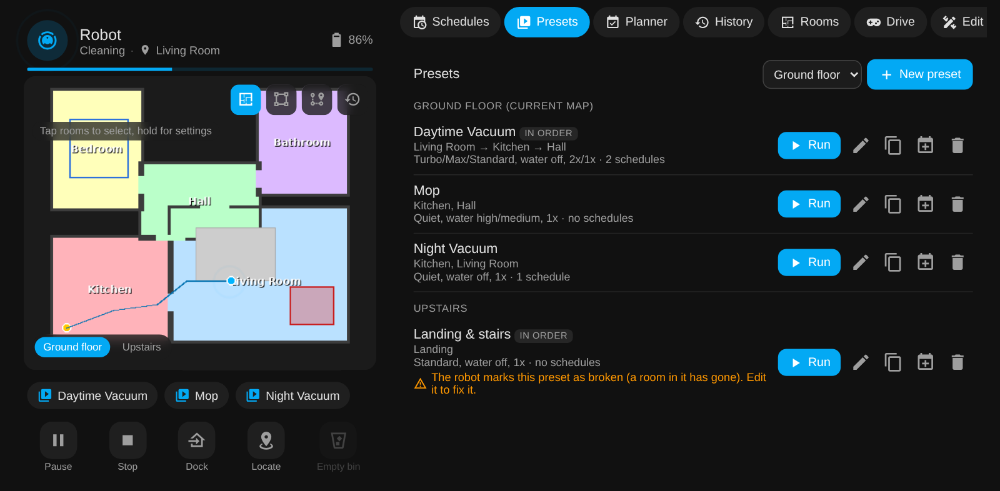
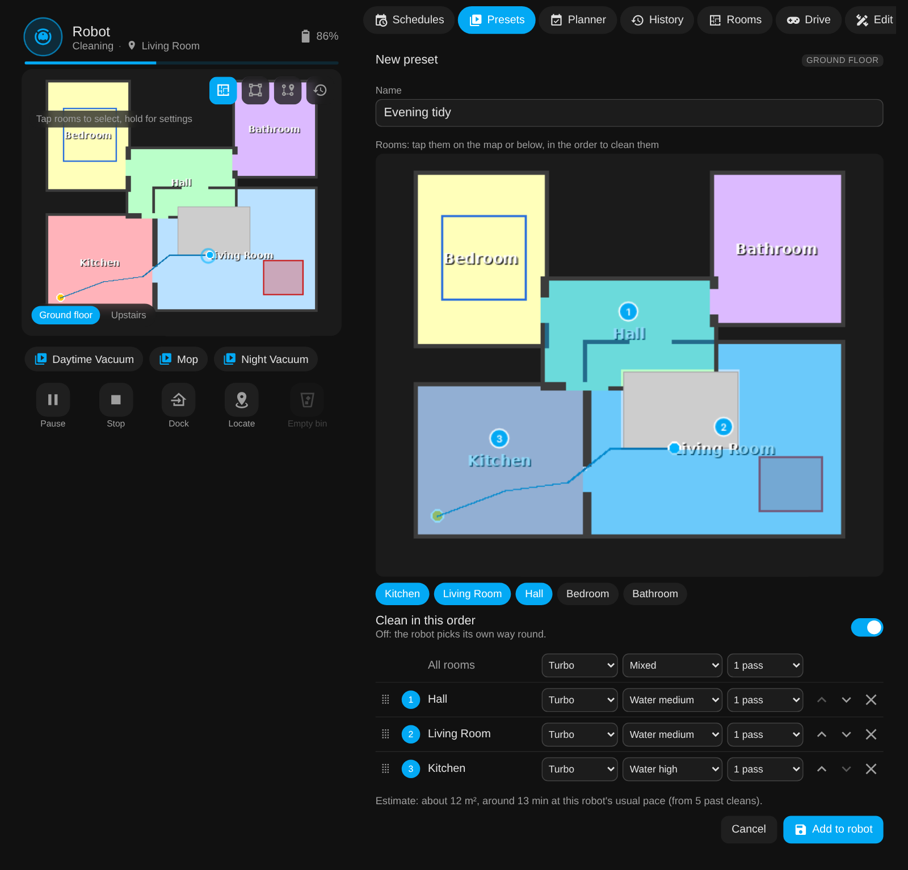
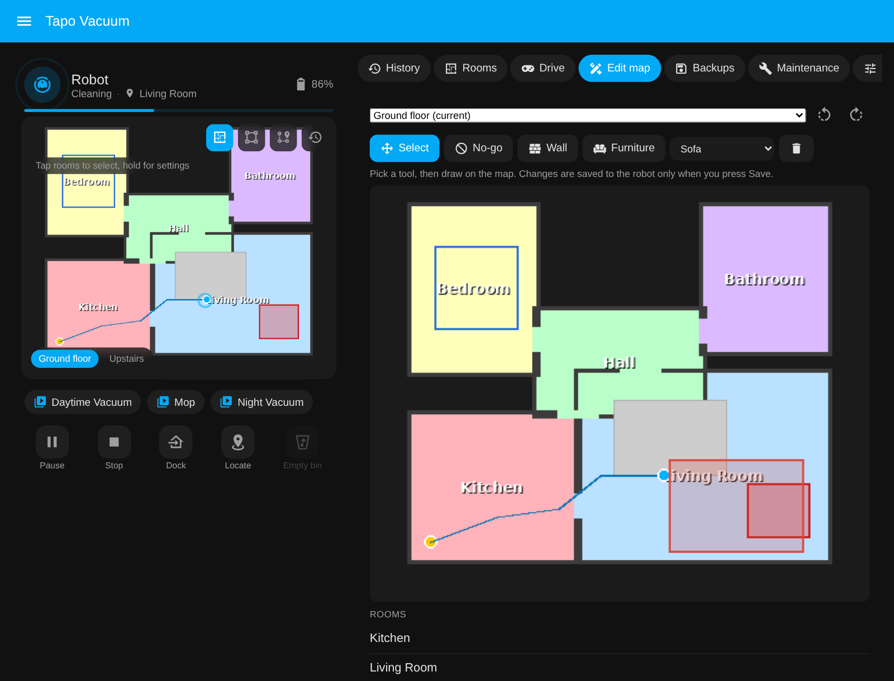
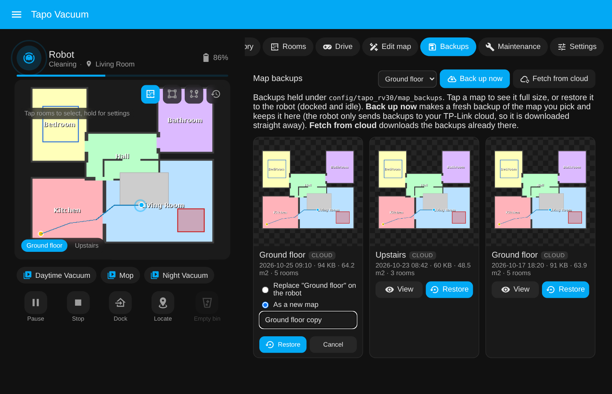
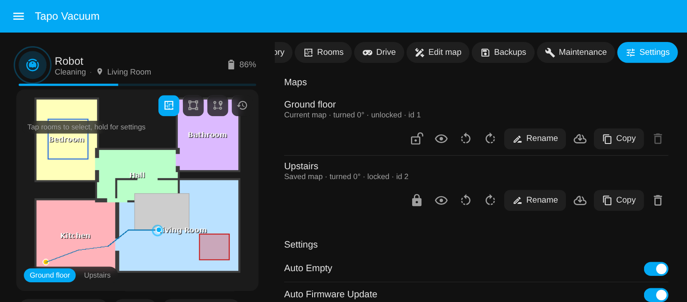

# The sidebar page

The integration adds **Tapo Vacuum** to the Home Assistant sidebar: one page with
everything it knows, so you do not have to build a dashboard to get going. The bundled
card is still there for your own dashboards; the page is the full-size version.

{ width="760" }

*Mock-up with a made-up house and made-up runs.*

## What is on it

### Map

The bundled card, full size: tap rooms, draw zones, floors, presets, controls, the status
panel with the last clean map, and the go-to tool (tap a point, press Go).

### Schedules

The robot's own schedules, the ones it runs with or without the app. Add, edit, enable or
disable and delete them with a form (start time, days, rooms or a preset or the whole
house, suction, water, passes). Nothing is stored in Home Assistant; it all goes to the
robot through `add_schedule`, `set_schedule` and `remove_schedule`.

A schedule whose start time falls inside the robot's **Do Not Disturb** window is flagged
in the list and in the editor, because the robot keeps it but never runs it (verified on an
RV30 Max Plus; the Tapo app shows the same warning). Saving or enabling one asks first. The
Do Not Disturb times are editable on the Settings tab.

{ width="640" }

### Presets

The robot's presets, map by map, with everything the Tapo app's preset editor has: a name, the
rooms (tap them on the map or in the list), their **cleaning order** (drag them, or use the
arrows; the map shows the order as numbers) with the "clean in this order" switch, and **each
room's own** suction, water and passes (or set them all at once). Presets on any saved map can be
edited, not just the current one.

On top of the app:

- **Estimated time and area** for the preset, from the rooms' size and how fast your robot has
  cleaned in its past runs.
- **Duplicate** a preset as the start of a new one.
- **Schedule** opens the schedule editor with the preset already picked.
- **Run** starts it now (asks first).
- **Delete** warns you when schedules run the preset, since the robot would leave them pointing at
  nothing.

{ width="760" }

{ width="760" }

Saving writes to the robot the same way the app does. For the map the robot is on, the map's setup
snapshot is updated straight away, so a later restore brings the preset back; another map's
snapshot catches up the next time the robot uses that map.

### Planner

Keeps each room within a target such as "every 2 days" and cleans the due rooms when
nobody is home, inside your time window, with motion sensors keeping it out of rooms in use.
It starts off and in preview mode. Everything about it is on [the planner](planner.md) page.

### History

Lifetime totals, cleans per day for the last 30 days, minutes per week for the last 8
weeks, and the recent runs with how they were started.

**Clean map history.** Press **Map** on a run to see where the robot went on it: cleaned
cells, the path, start, end and dock. **Download** saves it as a PNG; **Forget** deletes a kept
one. Each run's map is kept in Home Assistant when the integration reads the run (it already
does, to draw the Last Clean Map and work out room freshness), so keeping it costs the robot
nothing. Kept maps can be opened while the robot is cleaning or offline, and stay after the
robot drops the run from its own list (it only holds its most recent ones). A run that was not
kept but is still on the robot is marked "on robot" and is read from it when you open it,
once it is docked.

Choose how long maps are kept with **Keep maps** (Off, 1 week, 1 month, 3 months (the
default), 1 year, Forever) and how many at most with the **Clean Map History Limit** number
(200 by default, the oldest go first). Both are also entities on the device, so the Settings
tab and automations can change them. Turning history off deletes the kept maps. They are
stored compressed under `config/tapo_rv30/clean_history/<robot>/`, only the parts needed to
draw them (a one-room run here took 9 KB).

{ width="760" }

### Rooms

Each room with how recently it was cleaned and how much of it the robot covered, with a
one-tap clean button.

### Drive

The app's remote control. Take control and the robot drives off the dock; hold an arrow
button, or an arrow key, and it moves until you let go. Stop, vacuum while driving, spot
clean where it stands, locate, send it home. The map on the left follows it. Verified on an
RV30 Max Plus. If yours misbehaves, press Stop or Send home.

{ width="520" }

### Edit map

Draw on a map and save the result to the robot - no app. Pick which saved map to edit at the top
(the current one by default); a map the robot is not using is drawn and saved without switching
the robot to it. The turn buttons rotate the map being edited, keeping any unsaved edits, and
**Use this map** makes it the robot's current map. Pick a tool (**No-go**,
**Wall** or **Furniture**), draw on the map, and the change is held locally with **Undo** until
you press **Save to robot**; **Discard** throws the lot away. Select an item to move or delete
it. The robot must be docked and idle to save. Carpets and room names are drawn for context but
are view-only for now. Behind the scenes this is the robot's own editing API (`setAreaInfo` /
`setFurnitureInfo`), the same one the Tapo app uses.

{ width="760" }

### Backups

Every map backup Home Assistant holds, as a grid of thumbnails. Tap one to see it full size, or
press **Restore** to put it back on the robot (docked and idle): either over its map, or as a new
map with a name you give it. **Back up now** makes a fresh backup of the map you pick (any saved
map, not just the current one) and keeps it in Home Assistant: the robot only sends backups to
your TP-Link cloud, so Home Assistant downloads it straight away, with a progress bar while it
runs. **Fetch from cloud** downloads
your latest TP-Link backups into `config/tapo_rv30/map_backups/<robot>` without leaving the page. Each
backup is pictured from the robot's own snapshot or the saved map drawn like the live map, and
its `.bkmap` is decoded to show the explored floor area, dock and room count. See
[map backup and recovery](map-recovery.md) for the detail.

{ width="760" }

### Maintenance

Consumable life bars (amber under 30 percent, red under 10), Empty Bin, resets, and the
Omni dock actions where the dock has them.

### Settings

Every switch, select, number and time the robot exposes, Do Not Disturb included.

**Maps** lists the robot's saved maps with turn buttons (anticlockwise and clockwise; the map's
display rotation is stored on the robot, so the Tapo app shows it the same way) and a **Rename**
button for administrators (the same as
renaming in the Tapo app; the robot must be idle). Everything in the integration follows a map by its id, so
only automations that pass the old name as `map:` need updating. **Copy** makes a new map from
it with a name you give (rooms, names, no-go zones, furniture and presets, and if you tick the box
its schedules, switched off), so you can edit or try things
on the copy and leave the original alone; see [copying a map](map-recovery.md#restore-as-a-new-map-or-copy-a-map). The cloud button backs that map up
now and keeps the backup in Home Assistant (as **Back up now** on the Backups tab). The bin
button deletes a map that is not the current one, after a second press in the row. The eye
button previews a map full size. The padlock locks or unlocks a map, as in the Tapo app: a
locked map is kept as it is instead of being updated by later cleans (its room names, no-go zones
and furniture can still be edited). Backup, copy and restore show a progress bar while they run.

{ width="760" }

With more than one robot, each gets a tab in the header.

## Turning it off

Settings, Devices and services, Tapo Robot Vacuum, Configure, untick "Show the Tapo
Vacuum page in the sidebar". It disappears immediately and comes back the same way. With
several robots the page stays while any of them has it on.

## Compared with a dashboard

The page is the quickest way to everything, and most people will not need a dashboard at
all. If you want your own layout, the [dashboard strategy](card.md#whole-dashboard-in-one-line)
builds one from a single line, and the card drops into any dashboard you already have.
