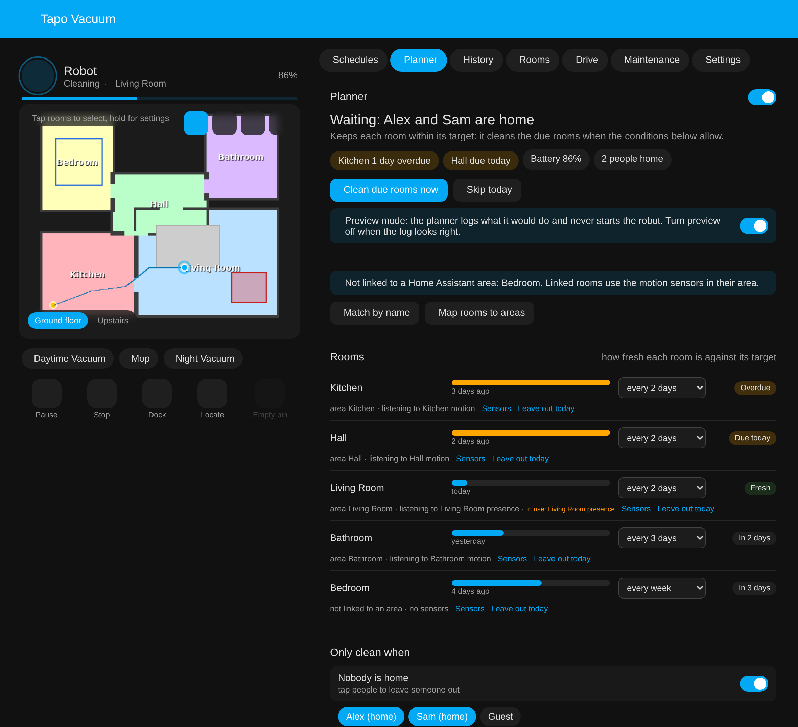
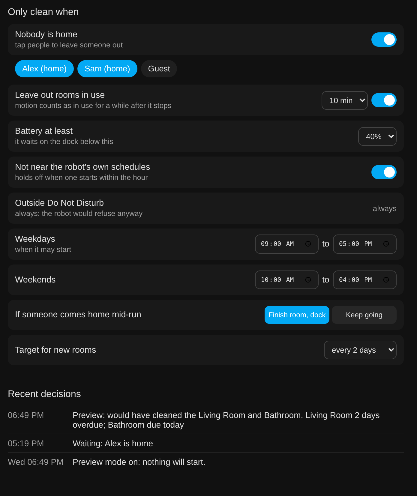

# The planner

The planner keeps each room within a target you choose, such as "every 2 days", instead of
cleaning at fixed times. It cleans the rooms that are due when the house allows it: nobody
home, inside your time window, outside Do Not Disturb, enough battery, and not in rooms that
are in use. It lives on the **Planner** tab of the [sidebar page](panel.md).

!!! note "Starts off, in preview mode"
    The planner arrives switched off and in preview mode, so nothing moves until you say so.
    It was verified on an RV30 Max Plus in preview against a real house. The "finish the
    room and dock when someone comes home" step has not been tested on a robot yet; please
    report how it behaves.

{ width="760" }

*Mock-up with a made-up house and made-up people.*

## Turning it on safely

1. Open the **Planner** tab and turn the planner on. It starts in **preview mode**: it works
   out what it would clean and logs it under **Recent decisions**, but never starts the
   robot.
2. Set a target per room, check which sensors each room listens to, and pick who counts as
   "home".
3. Watch the log for a day or two. When it reads right, turn preview off. From then on it
   starts the robot itself.

**Clean due rooms now** runs the due rooms straight away whatever the conditions (the robot
still has to be docked), and **Skip today** pauses the planner until tomorrow.

## Rooms

Every room on the robot's current map gets a row:

- **Freshness**: how long ago the room was cleaned against its target. The time comes from
  the robot's own run maps, the same per-room "last cleaned" the card shows.
- **Target**: every day, every 2, 3, 4 or 5 days, every week, every 2 weeks, or **leave out**.
  A room is due once it has gone its target without a clean; the most overdue go first.
- **Status**: Overdue, Due today, Fresh, or when it is next due.
- **Leave out today**: skips one room until tomorrow without changing its target.

### Rooms and Home Assistant areas

The planner uses the vacuum's own **map rooms to areas** setting, the one
`vacuum.clean_area` uses, so nothing is mapped twice. Rooms that are not linked yet are listed
on the tab with two buttons: **Match by name** links every room whose name matches an area
(Kitchen to Kitchen), and **Map rooms to areas** opens the vacuum's settings to link the
rest by hand.

Rooms and areas do not have to line up one to one. An open-plan area can hold several robot
rooms, and a robot room can belong to several areas; the room then listens to the sensors of
all of them.

### Sensors

A room listens to the motion, occupancy and presence sensors in its areas, picked for you.
**Sensors** on a room opens a list of every such sensor in Home Assistant: tap one to add it
from elsewhere, or tap a picked one to drop it, for example a motion sensor the pets set off.
**Ignore motion for this room** turns occupancy off for that room altogether.

A room counts as in use while a sensor is on and for a while after it turns off (10 minutes
by default; motion sensors blink). A due room that is in use is left out of the run and stays
due; if every due room is in use, the planner waits. Sensors are checked before a run starts,
so the robot setting off motion sensors as it cleans does not stop it.

## Only clean when

{ width="640" }

| Condition | Default | What it does |
|---|---|---|
| Nobody is home | on, everyone | Waits while any chosen person is home. Tap people to leave someone out, a guest or a phone with unreliable tracking. |
| Leave out rooms in use | on, 10 min | As above. |
| Battery at least | 40% | Waits on the dock until the battery reaches this. |
| Not near the robot's own schedules | on | Holds off when one of the robot's schedules starts within the hour. |
| Outside Do Not Disturb | always | The robot refuses to clean in Do Not Disturb anyway. |
| Weekdays, weekends | 09:00 to 17:00, 10:00 to 16:00 | When a run may start. One planner run per day. |
| If someone comes home mid-run | finish room, dock | Finishes the room it is in, then sends the robot home (untested on a robot so far). **Keep going** lets it carry on. |
| Target for new rooms | every 2 days | Used for rooms you have not set yourself, including new rooms after a remap. |

## Entities and events

- `switch.<name>_planner`: the planner on or off, for automations and dashboards.
- `sensor.<name>_planner_status`: what it is doing or waiting for, in one line ("Waiting:
  Alex is home"), with the due rooms and the reasons as attributes. After a failed start it
  shows "Could not start; trying again at HH:MM", with `action: wait` and `waiting_for: retry`.
- Event `tapo_rv30_planner`: fired when the planner starts a run (`kind: start`) or, in
  preview, when it would have (`kind: preview`), with the rooms.

Everything else, the targets, sensors, people and windows, is set on the tab and stored with
the integration.
